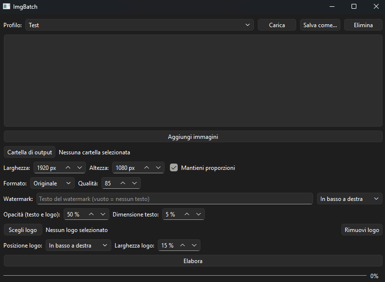

# ImgBatch

Programma per Windows con interfaccia grafica per elaborare molte immagini in una volta sola: ridimensiona, converte, comprime e applica watermark.



## Funzioni

- Ridimensionamento con o senza mantenimento delle proporzioni
- Conversione tra PNG, JPG e WebP
- Compressione con qualità regolabile
- Watermark di testo (posizione, opacità e dimensione)
- Watermark con logo (posizione e dimensione)
- Elaborazione in background con barra di avanzamento
- Profili salvabili per riutilizzare le impostazioni (es. "web", "Instagram")

## Requisiti

- Python 3.9 o superiore
- PyQt6 e Pillow (vedi `requirements.txt`)

## Installazione

```powershell
git clone https://github.com/Tambu-Code/imgbatch.git
cd imgbatch
python -m venv .venv
.venv\Scripts\activate
pip install -r requirements.txt
```

## Uso

```powershell
python main.py
```

1. Premi **Aggiungi immagini** e scegli i file.
2. Scegli una **cartella di output** diversa da quella degli originali.
3. Imposta dimensioni, formato, qualità e watermark.
4. Premi **Elabora**.

Il programma salva ogni immagine con lo stesso nome del file originale (cambia solo l'estensione se converti il formato). Se scegli come output la stessa cartella degli originali e lasci il formato "Originale", i file vengono sovrascritti.

### Profili

Con **Salva come...** puoi salvare tutte le impostazioni correnti con un nome, e richiamarle in qualsiasi momento con **Carica**. I profili vengono salvati nel file `.imgbatch_profiles.json` nella cartella utente, fuori dal progetto.

## Struttura del progetto

```
imgbatch/
├── core/
│   ├── processor.py    # elaborazione delle immagini
│   ├── watermark.py    # watermark di testo e logo
│   ├── settings.py     # impostazioni
│   └── profiles.py     # salvataggio dei profili
├── gui/
│   ├── main_window.py  # finestra principale
│   └── worker.py       # elaborazione in un thread separato
├── main.py
└── requirements.txt
```

La logica sulle immagini (`core/`) è separata dall'interfaccia (`gui/`), così può essere riutilizzata, ad esempio per una versione da riga di comando.

## Autore

Realizzato da [Tambu-Code](https://github.com/Tambu-Code).
